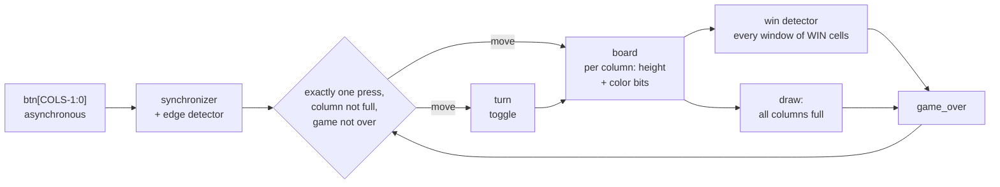

# Connect Four controller with formally proven game invariants

[](https://github.com/r800360/connect4-sv/actions/workflows/ci.yml)
[](LICENSE)

A synthesizable, parameterized Connect Four controller in SystemVerilog. It handles:
* button synchronization and edge detection;
* gravity and turn-taking;
* win detection over every window, draw detection, and a lockout once the game is over.

The focus is evidence that the game rules can never be broken: **seven invariants proven unbounded**, broken designs
that the proofs must catch, a bounded check of the full board, and a self-checking testbench against an independent
model.



## Results

| Check | Result |
|---|---|
| **P1–P7 game invariants** (list below), Yosys + ABC PDR | **proved unbounded** on a 4 × 4 board with 3 in a row, in about 5 minutes. The RTL is parameterized, so this is the same code as the 6 × 7 game |
| Four broken designs: turn never toggles, no lockout, simultaneous presses accepted, full columns ignored | each produces a counterexample (2–10 cycles deep) |
| Full 6 × 7 board, bounded model check (yosys-smtbmc + Z3) | no violation within 10 cycles of reset |
| Testbench: 15 directed games (13 kinds of win, a full-board draw, a near-win that must not count), 300 random games, robustness cases (Icarus and Verilator) | all pass, comparing all 42 cells and every flag after every press |
| Synthesis, 6 × 7 (Yosys, generic gates) | 840 cells: 85 flip-flops, 746 two-input gates, 9 inverters |

The invariants are:

| | Property |
|---|---|
| P1 | #red = #yellow + turn: turns alternate, and no token is lost or duplicated |
| P2 | gravity: no token sits above an empty cell |
| P3 | red and yellow never win at the same time |
| P4 | once the game is over, the board and turn are frozen until reset |
| P5 | a win never disappears until reset |
| P6 | a clock cycle changes at most one cell |
| P7 | one reset cycle gives an empty board with red to move |

## Reproduce

Every result comes from a pinned toolchain: Ubuntu 26.04 with Icarus Verilog 12.0, Verilator 5.032, Yosys 0.52 and
Z3 4.13 (see [`scripts/install-tools.sh`](scripts/install-tools.sh)).

```bash
docker build -t connect4-sv .
docker run --rm -u "$(id -u):$(id -g)" -v "$PWD":/work connect4-sv make ci     # lint, sims, proofs, synthesis
docker run --rm -u "$(id -u):$(id -g)" -v "$PWD":/work connect4-sv make full   # + full-board bounded check
```

`build/SUMMARY.md` collects every result. The targets are `lint`, `sim`, `formal`, `formal-quick` (without the
full-board check), `synth`, and `games` (regenerate the directed games).
* The *CI* workflow runs `make ci` on every push and uploads `build/`.
* *Full verification* runs `make full` on demand or for a `v*` tag. A tag also publishes a release with all outputs.

## Repository map

```
rtl/connect4.sv     the design
tb/                 self-checking testbench, directed games, tb_common.svh
formal/             invariants (connect4_formal.sv), pdr.sh, run_formal.sh (proof, mutants, BMC; expected outcomes)
scripts/c4model.py  Python game model; searches the shortest game ending in each kind of win
docs/               DESIGN.md (interface, architecture), VERIFICATION.md (every check, tool invocations)
```

Origin: this design began as a two-person schematic project in a university digital-design course, co-designed with
a course project partner. This repository is an independent SystemVerilog re-implementation. Analysis of the first
version (reset, turn-keeping and clocking bugs) motivated its focus on verification.

MIT License, © 2026 Rohan Sachdeva.
